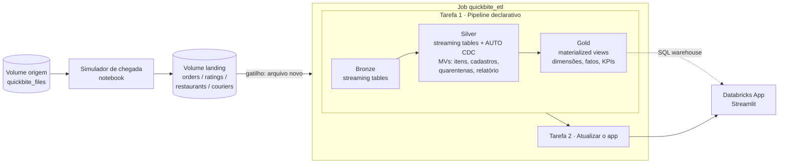

# QuickBite · projeto final de Engenharia de Dados no Databricks

Projeto ponta a ponta para o curso de Data Engineer: arquivos que **chegam aos poucos** num volume, um **pipeline declarativo** (bronze, silver, gold), um **job com gatilho de chegada de arquivo** e um **Databricks App** que lê a camada gold.

## Arquitetura

O mesmo desenho, em SVG, está em [`docs/arquitetura.svg`](docs/arquitetura.svg) e aparece dentro dos notebooks.

## Estrutura do repositório

| Pasta | Conteúdo |
|---|---|
| `exercicio/` | Notebook do exercício (requisitos, perguntas, células vazias) e arquivos vazios para o pipeline |
| `solucao/` | Notebook da solução, pipeline em **SQL** (`pipeline_sql/`) e em **Python** (`pipeline_python/`), e o app Streamlit (`app/`) |
| `apoio/` | `01_simulador_landing` (copia um lote por vez para o landing) e `02_deploy_app` (tarefa 2 do job) |
| `docs/` | Diagrama da arquitetura |

## Como usar no Databricks

1. **Clonar:** *Workspace → Create → Git folder* e cole a URL deste repositório.
2. **Dados de origem:** crie um volume (por exemplo `workspace.quickbite.quickbite_files`) e coloque nele os 14 arquivos `orders_*.json`, `ratings.csv`, `restaurants.csv` e `couriers.csv`. Os dados não estão neste repositório.
3. **Alunos:** abram `exercicio/00_EXERCICIO_projeto_quickbite`. **Instrutor:** `solucao/00_SOLUCAO_projeto_quickbite`.
4. O simulador (`apoio/01_simulador_landing`) cria o volume `landing` e copia um lote por vez.

Os dois pipelines (SQL e Python) produzem as mesmas tabelas. Rode um por vez no mesmo schema, ou use schemas diferentes.

### Parâmetros do pipeline (Configuration)

| Chave | Valor de exemplo |
|---|---|
| `landing_path` | `/Volumes/workspace/quickbite/landing` |
| `sla_minutes` | `45` |
| `qb_catalog` | `workspace` |
| `qb_schema` | `quickbite` |

## O que o pipeline faz

| Camada | Objetos | Como |
|---|---|---|
| Bronze | `bronze_orders`, `bronze_ratings`, `bronze_restaurants`, `bronze_couriers` | streaming tables lendo o landing, com arquivo de origem e hora da ingestão |
| Silver | `silver_orders`, `silver_ratings` | streaming tables com *expectations* e `AUTO CDC` para deduplicar |
| Silver | itens, clientes, restaurantes, entregadores, quarentenas, relatório de qualidade | materialized views (reavaliam sozinhas o que chega atrasado) |
| Gold | `dim_*`, `fact_orders`, `fact_order_items`, `gold_*` | materialized views, com chaves primárias e estrangeiras informativas |

Números esperados com os 8 lotes no landing: 786 linhas de pedidos, 709 pedidos válidos, 1.394 itens, 34 pedidos de teste em quarentena, 385 avaliações ligadas a pedidos entregues, receita de € 20.584,50.

## O job

* **Gatilho:** chegada de arquivo no volume `landing`.
* **Tarefa 1:** pipeline (atualização incremental).
* **Tarefa 2:** valida a gold e reimplanta o app (`apoio/02_deploy_app`).

A solução cria pipeline, app e job pelo SDK do Databricks; também dá para montar tudo pela interface.

## Permissões do app

O app roda com um service principal próprio. Ele precisa de `CAN USE` no SQL warehouse (recurso do app) e de `USE CATALOG`, `USE SCHEMA` e `SELECT` nas tabelas gold.
